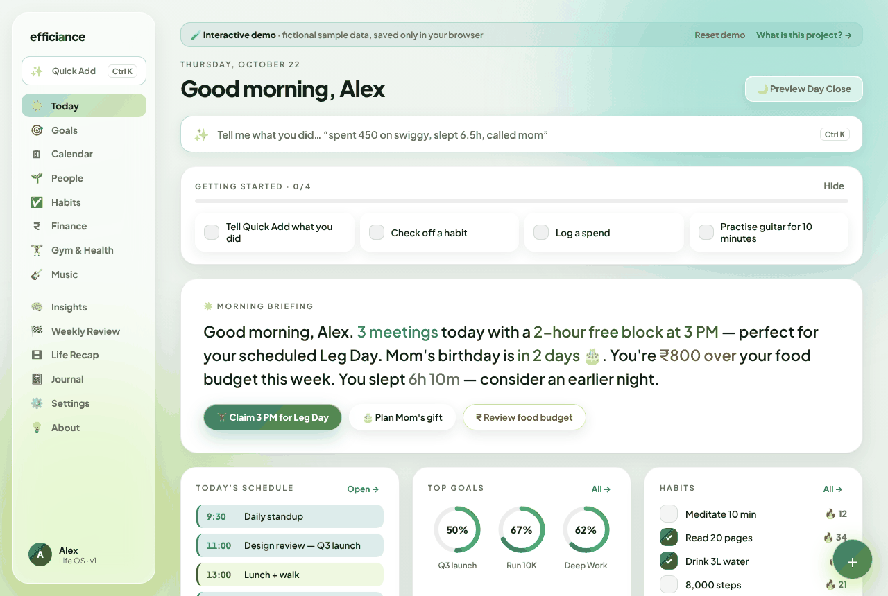
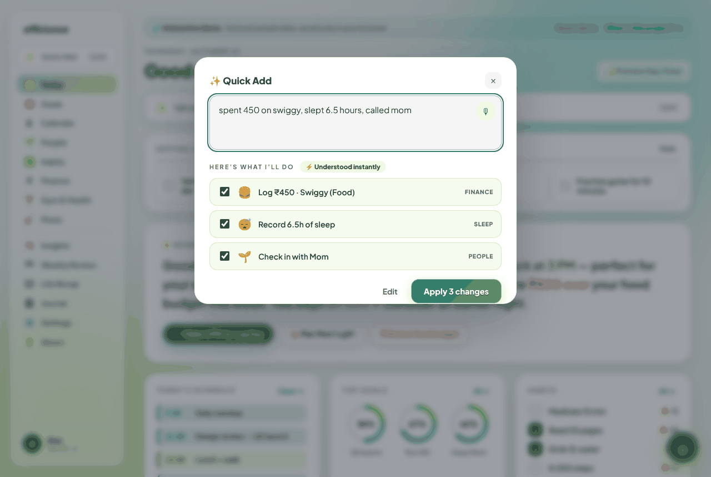
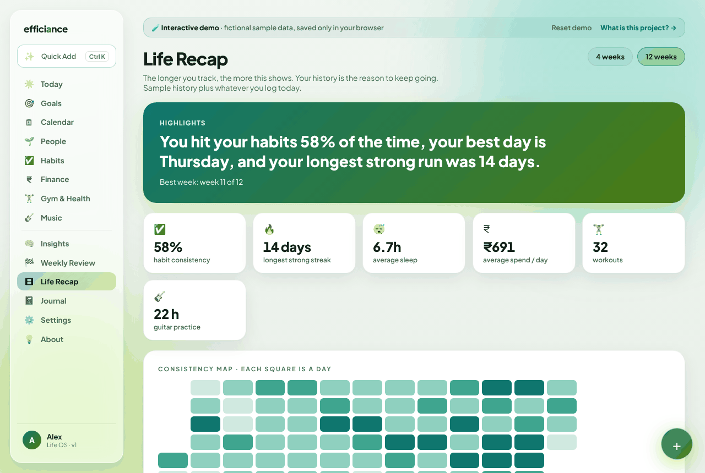
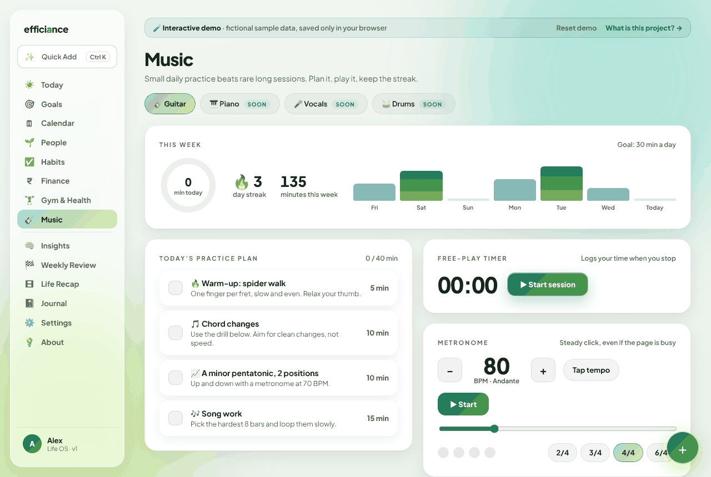
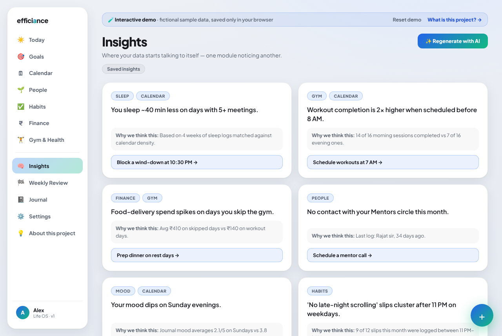
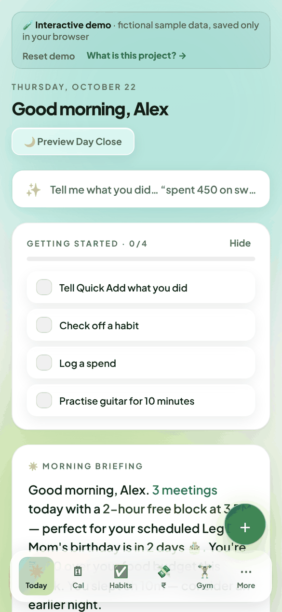

# Efficiance — Life OS

> You have just 1 life. Why not track it like your biggest project?

One intelligence layer over seven modules (calendar, goals, people, habits, finance, gym & health, journal) with AI cross-module insights.
Everything you track stays in your browser (localStorage); a small Express server only relays AI and Google Calendar calls.

**Live demo:** [efficiance.onrender.com](https://efficiance.onrender.com) · [Source](https://github.com/abhyank-singh/efficiance) · **Built by** [Abhyank Singh](https://www.linkedin.com/in/abhyank-singh/)

| Today | Quick Add | Life Recap |
|---|---|---|
|  |  |  |
| **Music** | **Insights (live AI)** | **Mobile** |
|  |  |  |

## Two builds, one codebase

| | **Demo** (public showcase) | **Personal** (your own copy) |
|---|---|---|
| Data | Fictional persona "Alex", sample week | Your name; stored in your browser |
| Extras | About page, guided tour, demo banner | Live Google Calendar (optional) |
| AI | Strict rate limits + daily cap | Generous limits (or fully local with Ollama) |
| Runs on | Render (Docker) | Your laptop |

## Run on your Mac (personal)

Requires [Node.js LTS](https://nodejs.org). Then either double-click **`Efficiance.command`**, or:

```bash
npm install
cp .env.example .env     # optional: add an AI key (see below)
npm run personal         # builds + serves http://localhost:3001
```

Tip: open it in Chrome/Edge → ⋮ → *Install Efficiance*, or Safari → File → *Add to Dock* for a standalone app window.
Your data lives in that browser's storage for `localhost:3001`; use **Settings → Export my data** for backups.

## Try the demo build locally

```bash
npm run demo             # http://localhost:3001 in demo mode
```

## What's inside

- **Quick Add (⌘K / Ctrl K):** type or speak "spent 450 on swiggy, slept 6.5h, called mom". It proposes the changes, you confirm, and you can undo. An instant offline parser handles common sentences; the AI handles the rest. All model output is validated before it can touch app state (`shared/schema.js`).
- **Installable web app:** offline-capable PWA (Settings → Install). Works on Mac, Windows, Android and iPhone.
- **Music (guitar first):** practice plan, free-play timer, metronome, chord library with diagrams, chord-change drill, tuning reference, repertoire. New instruments plug into a registry (`src/pages/Music.jsx`).
- **Life Recap:** 12-week trends, consistency heatmap and a downloadable share card.
- **Onboarding:** starter packs and a "first win" step, plus a Getting-started checklist.
- **Metrics:** privacy-friendly event tracking (optional GoatCounter), documented on the About page.

## AI provider (pick one in `.env`)

- **Gemini** (free tier available) — `AI_PROVIDER=gemini`, `GEMINI_API_KEY=…`
- **Any OpenAI-compatible API** (OpenAI, Groq, OpenRouter) — `AI_PROVIDER=openai`, `OPENAI_API_KEY`, `OPENAI_BASE_URL`, `OPENAI_MODEL`
- **Local, free, private** — [Ollama](https://ollama.com), `OPENAI_BASE_URL=http://localhost:11434/v1`

Without a key the app uses its saved insights; nothing breaks.

## Honest scope

This is a portfolio prototype. Most modules show sample data, the Fitbit / Google Health / Apple Health / bank / UPI
integrations are **planned previews**, and Google Calendar sync only works in the personal build. Quick Add, Music,
the Recap and the AI insights are real and working.

## Troubleshooting the AI

Open `/api/ai/ping` on your deployment. It makes one tiny model call and reports the model in use or the exact error.
Gemini retires models periodically; the server auto-switches to an available Flash-Lite model when that happens.

## Extending it

See [EXTENDING.md](EXTENDING.md): re-skin the palette, add modules, instruments and Quick Add actions.

## Deploy the demo

See [DEPLOY_GUIDE.md](DEPLOY_GUIDE.md).

## Architecture

Single container: Express (Node 22) serves the built React SPA and the API (`/api/ai/insights`, `/api/google/*`, `/api/health`).
Product spec: [spec.md](spec.md).

## License

MIT, see [LICENSE](LICENSE).
