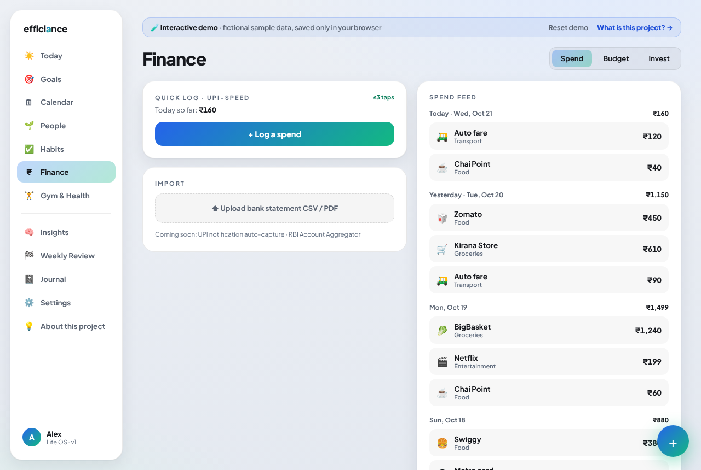

# Efficiance — Life OS

> You have just 1 life. Why not track it like your biggest project?

One intelligence layer over seven modules (calendar, goals, people, habits, finance, gym & health, journal) with AI cross-module insights.
Everything you track stays in your browser (localStorage); a small Express server only relays AI and Google Calendar calls.

**Live demo:** _add your Render URL here after deploying_ · [Source](https://github.com/abhyank-singh/efficiance) · **Built by** [Abhyank Singh](https://www.linkedin.com/in/abhyank-singh/)

| Today | Insights (live AI) | Finance |
|---|---|---|
|  |  |  |

## Two builds, one codebase

| | **Demo** (public showcase) | **Personal** (your own copy) |
|---|---|---|
| Data | Fictional persona "Alex", sample week | Your name; stored in your browser |
| Extras | About page, guided tour, demo banner | Live Google Calendar (optional) |
| AI | Strict rate limits + daily cap | Generous limits (or fully local with Ollama) |
| Runs on | Render (Docker) | Your laptop |

## Run on your Mac (personal)

Requires [Node.js LTS](https://nodejs.org). Then either double-click **`Efficiance.command`**, or:

```bash
npm install
cp .env.example .env     # optional: add an AI key (see below)
npm run personal         # builds + serves http://localhost:3001
```

Tip: open it in Chrome/Edge → ⋮ → *Install Efficiance*, or Safari → File → *Add to Dock* for a standalone app window.
Your data lives in that browser's storage for `localhost:3001`; use **Settings → Export my data** for backups.

## Try the demo build locally

```bash
npm run demo             # http://localhost:3001 in demo mode
```

## AI provider (pick one in `.env`)

- **Gemini** (free tier available) — `AI_PROVIDER=gemini`, `GEMINI_API_KEY=…`
- **Any OpenAI-compatible API** (OpenAI, Groq, OpenRouter) — `AI_PROVIDER=openai`, `OPENAI_API_KEY`, `OPENAI_BASE_URL`, `OPENAI_MODEL`
- **Local, free, private** — [Ollama](https://ollama.com), `OPENAI_BASE_URL=http://localhost:11434/v1`

Without a key the app uses its saved insights; nothing breaks.

## Deploy the demo

See [DEPLOY_GUIDE.md](DEPLOY_GUIDE.md).

## Architecture

Single container: Express (Node 22) serves the built React SPA and the API (`/api/ai/insights`, `/api/google/*`, `/api/health`).
Product spec: [spec.md](spec.md).
